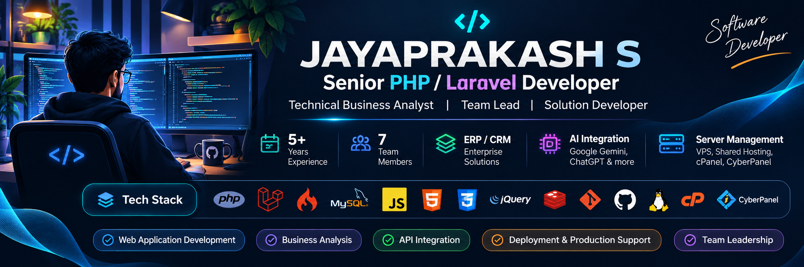

  

# 👋 Hi, I'm Jayaprakash S

### Senior PHP / Laravel Developer · Technical Business Analyst

**Enterprise Applications · ERP/CRM · REST APIs · AI Integration · Server & Deployment**

**From business requirements to production-ready applications.**

---

## 🚀 About Me

I'm a **Senior PHP / Laravel Developer and Technical Business Analyst** with **5+ years of experience** building, customizing and maintaining web applications and enterprise business solutions. I work across **backend development, database design, ERP/CRM workflows, REST APIs, client requirement analysis, deployment and production support**.

- 💻 Develop with **PHP, Laravel, CodeIgniter, MySQL, JavaScript and jQuery**.
- 🏢 Build business workflows for **ERP, CRM, inventory, purchasing, sales, invoicing and reporting**.
- 🔗 Integrate **payment gateways, GST e-Invoicing/e-Way Bill, SMS, WhatsApp and third-party APIs**.
- 🤖 Integrated a **Google Gemini-powered chatbot** into a Laravel ERP application.
- 👥 Coordinate a **7-member cross-functional team**, while contributing hands-on to development.
- 🖥️ Hands-on with **VPS, shared hosting, Linux, cPanel, CyberPanel and web application deployment**.

## 🧰 Technology Stack

**Backend & APIs**

   

**Frontend**

   

**Databases & Real-Time**

  

**Infrastructure & Tools**

        

**AI-Assisted Development**

Google Gemini API · ChatGPT · Claude · GitHub Copilot

## 🖥️ Server, Hosting & Deployment

**Hands-on practical experience** supporting web application hosting, deployment and production operations.

| Area | Hands-on skills |
|---|---|
| Hosting | VPS, Shared Hosting |
| Control panels | cPanel, CyberPanel |
| Operating systems & web servers | Linux, Apache, Nginx |
| Domains & security | Domain and DNS configuration, SSL installation |
| PHP environments | PHP versions and extensions |
| Databases | MySQL backup and restore |
| Operations | Cron jobs, SSH, file permissions |
| Hosting services | Email hosting |
| Delivery | Application deployment, troubleshooting and maintenance |

## 💼 Professional Experience

### Senior Developer / Technical Business Analyst
**Idreamdevelopers · December 2021 – Present**

- Work directly with clients to gather requirements, analyse processes and translate business needs into technical workflows.
- Develop and customize PHP/Laravel/CodeIgniter web applications, forms, tables, graphs and backend business logic.
- Build REST APIs for mobile apps and coordinate integration with mobile development teams.
- Design MySQL database structures and implement ERP/CRM modules spanning inventory, stock, inward, delivery challan, item issue, job work, purchasing, sales, invoicing and reporting.
- Implement GST/HSN-related workflows, e-Invoicing, e-Way Bills, payment gateways, SMS and WhatsApp integrations.
- Coordinate **3 PHP developers (including myself), 2 UI/UX designers and 2 mobile application developers**.
- Support shared hosting/VPS deployments, production troubleshooting and ongoing customizations.

## 🏗️ Selected Project Experience

> These are professional project case studies, not links to public source code. Client-owned implementations are not published here.

### 🏢 01 · Customized ERP Solutions
**Enterprise operations and process automation**

Built and customized ERP workflows for multiple client businesses, including inventory, stock, inward, purchase, sales, invoicing, delivery challans, item issues and job work. Implemented in-house **Job Order Management** with process tracking, alongside HSN-based GST reporting, e-Invoicing and e-Way Bill functionality.

`PHP` `Laravel` `CodeIgniter` `MySQL` `JavaScript` `jQuery` `REST APIs`

### 🚜 02 · Earth Movers ERP
**Vehicle, equipment and project monitoring**

Implemented vehicle management, mileage and usage tracking, service and maintenance workflows, vehicle running-hour monitoring, equipment utilization and project monitoring features.

`PHP` `Laravel` `MySQL` `JavaScript` `REST APIs`

### 🚕 03 · Taxi Management System
**Booking, trips and real-time communication**

Developed taxi booking and trip-related workflows with **WebSockets** for real-time application updates and **Redis** supporting the real-time workflow. Contributed backend logic, database operations and frontend integration.

`PHP` `Laravel` `MySQL` `Redis` `WebSockets` `JavaScript` `jQuery`

### 🏠 04 · Real Estate CRM
**Customized business workflows**

Analysed client requirements, developed CRM backend and database functionality, integrated frontend workflows and supported testing and deployment.

`PHP` `Laravel / CodeIgniter` `MySQL` `JavaScript`

### 🐔 05 · Poultry ERP
**Bird, CRM, feed and materials management**

Developed business workflows for bird management, customer relationship management, feed production materials, and material/cage tracking.

`PHP` `Laravel` `MySQL`

### 💍 06 · Matrimony Portal
**Profiles and user workflows**

Contributed to profile management, custom application features, backend operations and frontend/backend integration.

`PHP` `MySQL` `JavaScript` `jQuery`

### 🤖 07 · AI-Powered ERP Chatbot
**Google Gemini integration**

Integrated a **Google Gemini-powered chatbot** into a Laravel-based ERP application, introducing AI-assisted interaction into existing enterprise workflows.

`PHP` `Laravel` `Google Gemini API`

### 🧩 Additional Business Applications

`eCommerce` · `Job Portal` · `HRM` · `Vehicle Management System` · `Task Management`

## 🤝 Technical Leadership & Business Analysis

- Lead client discussions, clarify business rules and define technical approaches.
- Break requirements into development tasks and coordinate delivery across PHP, design and mobile teams.
- Align API behavior, frontend integration, testing, deployment and production support.
- Balance hands-on development with cross-functional coordination.

## 🎓 Education

**Bachelor of Engineering (Mechanical Engineering)**  
Asian College of Engineering and Technology · 2018

**Languages:** Tamil · English · Kannada

## 📈 GitHub Activity

> GitHub widgets reflect public repository activity only; professional client work may not appear here. Third-party widgets may occasionally be unavailable.

## 📬 Connect

- 📍 **Coimbatore, Tamil Nadu, India**
- ✉️ **[jayaprakashppy@outlook.com](mailto:jayaprakashppy@outlook.com)**
- 💻 **[github.com/jayaprakash-s](https://github.com/jayaprakash-s)**

---

### ✨ Building Smart Solutions. Engineering Scalable Applications.

**Thanks for visiting my portfolio!**

