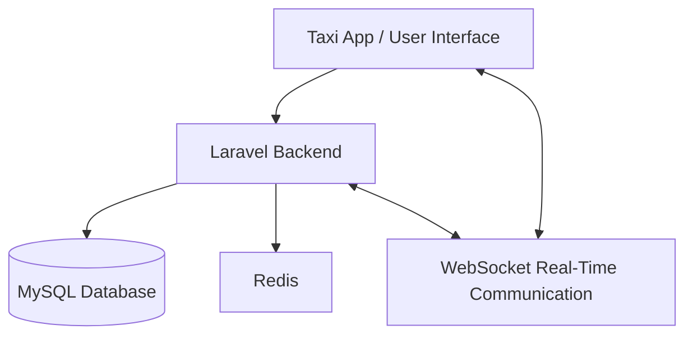
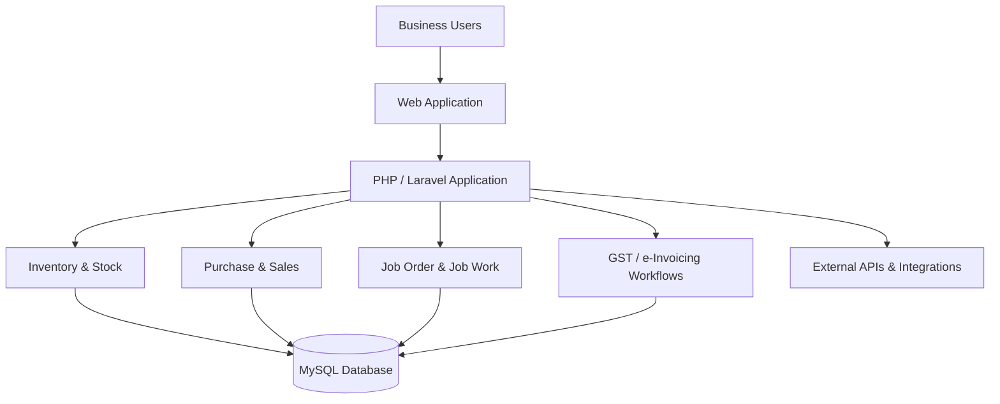
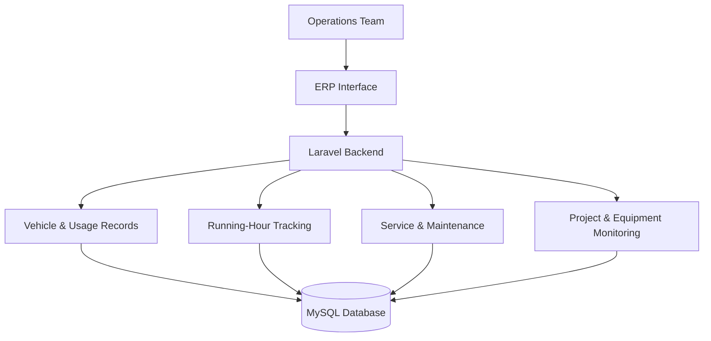
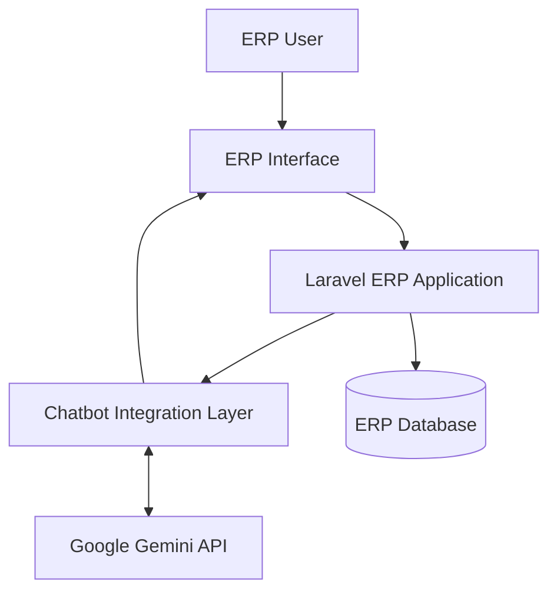
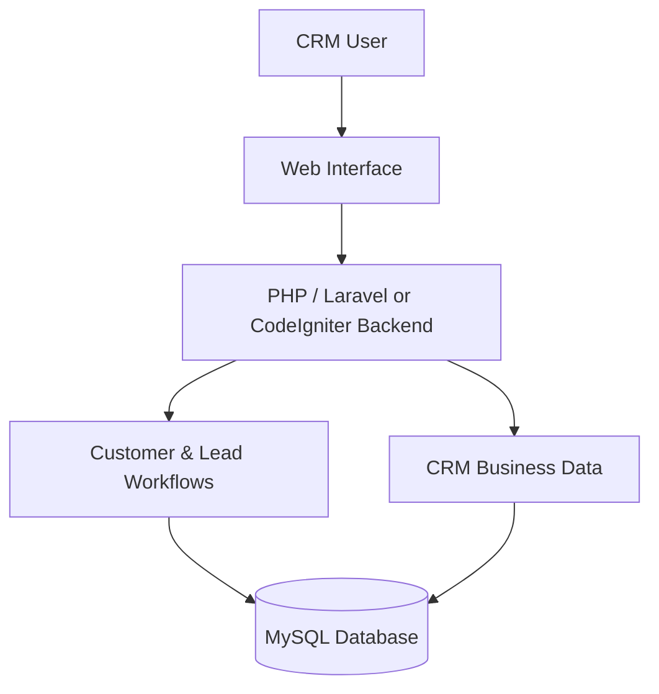
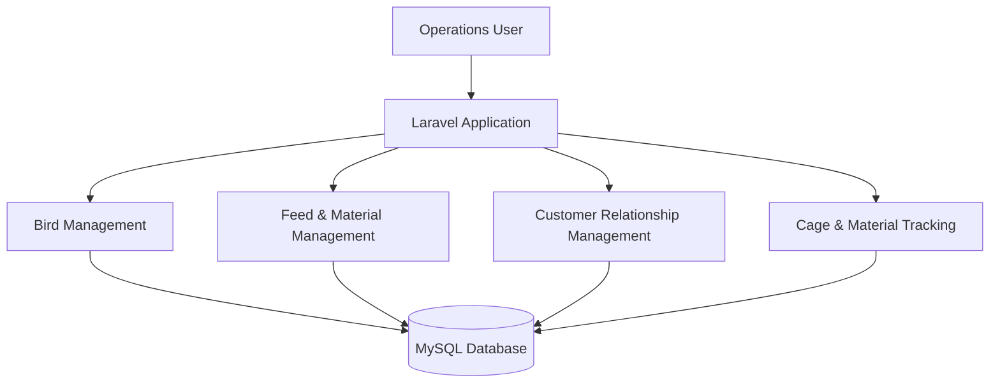
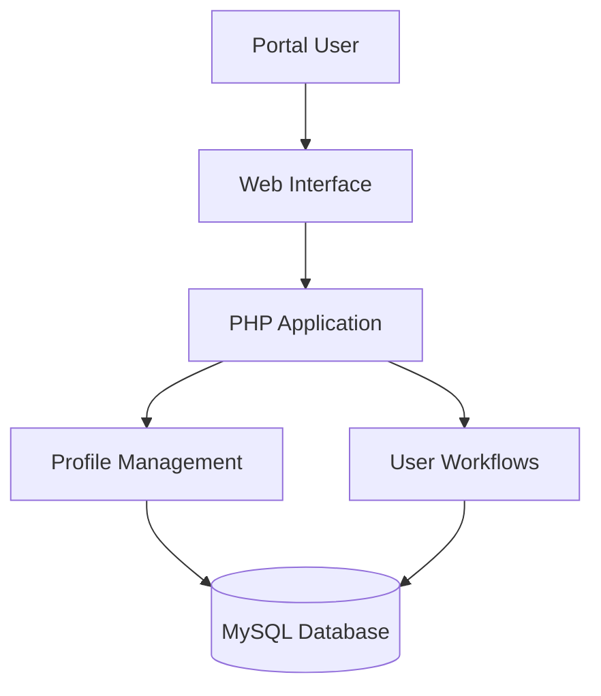

  
  <h1>Jayaprakash S</h1>
  <h3>Senior PHP / Laravel Developer</h3>
  
<strong>Technical Business Analyst · Team Lead · Server & Deployment</strong>

  
Enterprise Applications · ERP / CRM · REST APIs · AI Integration · Infrastructure

  

    
    
    
  

  <em>From business requirements to production-ready applications.</em>

---

## 👋 About Me

I'm **Jayaprakash S**, a Senior PHP / Laravel Developer and Technical Business Analyst with **5+ years of professional experience** building, customizing and maintaining web applications and enterprise business solutions.

I work across the software delivery lifecycle — from understanding client requirements and translating business processes into technical workflows to backend development, database operations, API integration, deployment and production support.

- **Backend engineering:** PHP, Laravel, CodeIgniter, MySQL, JavaScript and jQuery.
- **Enterprise solutions:** ERP / CRM workflows for inventory, purchasing, sales, invoicing, job orders and reporting.
- **API integrations:** REST APIs, payment gateways, GST-related services, e-Invoicing, e-Way Bill, SMS, WhatsApp and third-party APIs.
- **AI integration:** Integrated a Google Gemini-powered chatbot into a Laravel ERP application.
- **Technical leadership:** Coordinate a 7-member cross-functional team while contributing hands-on to development.
- **Infrastructure:** Hands-on experience with VPS, shared hosting, Linux, cPanel, CyberPanel and web application deployment.

## ⚡ Technical Expertise

### Backend Engineering

`PHP` `Laravel` `CodeIgniter` `REST API Development` `Backend Business Logic`

### Frontend Development

`HTML5` `CSS3` `JavaScript` `jQuery` `Forms` `Tables` `Graphs` `Frontend–Backend Integration`

### Database & Real-Time Technologies

`MySQL` `Redis` `WebSockets`

### Server, Hosting & Deployment

**Hands-on practical experience**
- **Hosting:** VPS and shared hosting
- **Control panels:** cPanel and CyberPanel
- **Web servers:** Apache and Nginx
- **Linux operations:** SSH access and file permissions
- **Domains & security:** Domain configuration, DNS configuration and SSL installation
- **PHP environments:** PHP version and extension configuration
- **Database operations:** MySQL backup and restore
- **Scheduled tasks:** Cron job configuration
- **Hosting services:** Email hosting
- **Delivery:** Application deployment, troubleshooting and maintenance

### Developer Tools & AI

`Git` `GitHub` `Postman` `Composer` `Google Gemini API` `ChatGPT` `Claude` `GitHub Copilot`

### Integrations
`Payment Gateways` `GST Workflows` `HSN-based Reporting` `e-Invoicing` `e-Way Bill` `SMS APIs` `WhatsApp APIs` `Third-party APIs`

---

## 💼 Professional Experience

### Senior Developer / Technical Business Analyst
**Idreamdevelopers** · December 2021 – Present

- Work directly with clients to gather requirements, analyse business processes, clarify business rules and translate needs into technical specifications and application workflows.
- Develop and customize web applications using PHP, Laravel, CodeIgniter, MySQL, JavaScript, jQuery, HTML and CSS.
- Build frontend forms, tables and graphs, connecting user interfaces with backend business logic and databases.
- Develop REST APIs and backend services for mobile applications, coordinating data exchange with mobile application developers.
- Design database structures and implement ERP / CRM business logic across inventory, stock, inward, delivery challan, item issue, job work, purchase, sales, invoicing and reporting workflows.
- Implement GST-related workflows and integrations, including HSN-based reporting, e-Invoicing, e-Way Bills, payment gateways, SMS, WhatsApp and other third-party APIs.
- Coordinate a **7-member cross-functional team**: 3 PHP developers (including myself), 2 UI/UX designers and 2 mobile application developers.
- Support application deployment and maintenance on shared hosting and VPS environments, troubleshoot production issues and deliver ongoing customizations.

---

## 🏗️ Selected Project Experience

> These are professional project case studies based on my work experience. Client-owned source code and confidential implementation details are not published here.

<table>
  <tr>
    <td width="50%" valign="top">
      <h3>🏢 01 · Customized ERP Solutions</h3>
      <strong>Enterprise operations & process automation</strong>
      
Customized ERP workflows for multiple client businesses, covering inventory, inward, stock, purchase, sales, invoicing, delivery challan, item issue and job work. Implemented in-house Job Order Management with process tracking, plus GST-related workflows, HSN-based reporting, e-Invoicing and e-Way Bill functionality.

      PHP · Laravel · CodeIgniter · MySQL · JavaScript · jQuery · REST APIs
    </td>
    <td width="50%" valign="top">
      <h3>🚜 02 · Earth Movers ERP</h3>
      <strong>Vehicle, equipment & project monitoring</strong>
      
Vehicle management, mileage and usage tracking, service and maintenance workflows, running-hour monitoring, equipment utilization and project monitoring.

      PHP · Laravel · MySQL · JavaScript · REST APIs
    </td>
  </tr>
  <tr>
    <td width="50%" valign="top">
      <h3>🚕 03 · Taxi Management System</h3>
      <strong>Booking, trip management & real-time communication</strong>
      
Developed and customized taxi booking and trip-related workflows. Implemented real-time communication and application updates using WebSockets, with Redis supporting the real-time workflow. Contributed to backend development, database operations and frontend–backend integration.

      PHP · Laravel · MySQL · Redis · WebSockets · JavaScript · jQuery
    </td>
    <td width="50%" valign="top">
      <h3>🏠 04 · Real Estate CRM</h3>
      <strong>Customized real estate workflows</strong>
      
Client requirement analysis, customized CRM workflows, backend functionality, database operations, frontend integration, testing and deployment support.

      PHP · Laravel / CodeIgniter · MySQL · JavaScript
    </td>
  </tr>
  <tr>
    <td width="50%" valign="top">
      <h3>🐔 05 · Poultry ERP</h3>
      <strong>Bird, CRM & feed management</strong>
      
Bird management, CRM functionality, feed management, material tracking and cage-related workflows.

      PHP · Laravel · MySQL
    </td>
    <td width="50%" valign="top">
      <h3>💍 06 · Matrimony Portal</h3>
      <strong>Profiles & user workflows</strong>
      
Profile management, customized application features, backend operations and frontend–backend integration.

      PHP · MySQL · JavaScript · jQuery
    </td>
  </tr>
  <tr>
    <td colspan="2" valign="top">
      <h3>🤖 07 · AI-Powered ERP Chatbot</h3>
      <strong>Google Gemini API integration</strong>
      
Integrated a Google Gemini-powered chatbot into a Laravel-based ERP application, connecting chatbot functionality with existing ERP workflows to introduce AI-assisted interaction.

      PHP · Laravel · Google Gemini API
    </td>
  </tr>
</table>

### Taxi Management System — High-Level Architecture

*Illustrative high-level diagram based on the project technologies described; it does not claim to represent the exact production deployment topology.*

### Project Architecture Snapshots

The following diagrams are **high-level illustrative views** based on the project descriptions and technologies listed above. They are not representations of verified client production infrastructure.

#### 🏢 ERP Solutions — Business Workflow

#### 🚜 Earth Movers ERP — Vehicle & Equipment Monitoring

#### 🤖 AI-Powered ERP Chatbot — Gemini Integration

#### 🏠 Real Estate CRM — Lead & Customer Workflow

#### 🐔 Poultry ERP — Operations Workflow

#### 💍 Matrimony Portal — Profile Workflow

### Additional Business Applications
`eCommerce` · `Job Portal` · `HRM` · `Vehicle Management System (VMS)` · `Task Management`

---

## 🖥️ Server & Deployment Capability

Hands-on experience supporting web application hosting, deployment and production operations.

| Area | Practical experience |
|---|---|
| Hosting | VPS, Shared Hosting |
| Control panels | cPanel, CyberPanel |
| Operating systems & web servers | Linux, Apache, Nginx |
| Domains & security | Domain and DNS configuration, SSL installation |
| PHP environments | PHP versions and extensions |
| Database operations | MySQL backup and restore |
| Scheduled operations | Cron jobs |
| Server access | SSH and file permissions |
| Hosting services | Email hosting |
| Application delivery | Deployment, troubleshooting and maintenance |

---

## 👥 Technical Leadership & Business Analysis

I combine hands-on development with client communication and cross-functional coordination.

| Team role | Members |
|---|---:|
| PHP developers (including myself) | 3 |
| UI/UX designers | 2 |
| Mobile application developers | 2 |
| **Total** | **7** |

- Lead client discussions, understand requirements and clarify functional expectations.
- Break requirements into development tasks and coordinate implementation.
- Align web and mobile teams on API requirements, application behaviour and UI integration.
- Contribute hands-on across analysis, development, integration, testing, deployment and production support.

## 🎓 Education

**Bachelor of Engineering (B.E.), Mechanical Engineering**  
Asian College of Engineering and Technology · 2018

## 🌐 Languages

Tamil · English · Kannada

---

## 📊 GitHub Overview

  
  

  GitHub widgets reflect public repository activity only. Professional work in private or client-owned repositories may not appear here. Third-party widgets may occasionally be unavailable.

---

## 📬 Let's Connect

- **Location:** Coimbatore, Tamil Nadu, India
- **Email:** [jayaprakashppy@outlook.com](mailto:jayaprakashppy@outlook.com)
- **GitHub:** [github.com/jayaprakash-s-dev](https://github.com/jayaprakash-s-dev)

---

### Building Smart Solutions. Engineering Scalable Applications.

**Thanks for visiting my developer portfolio!**

